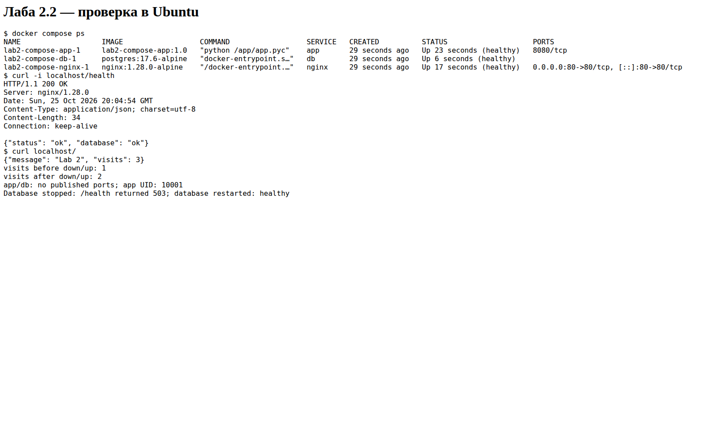
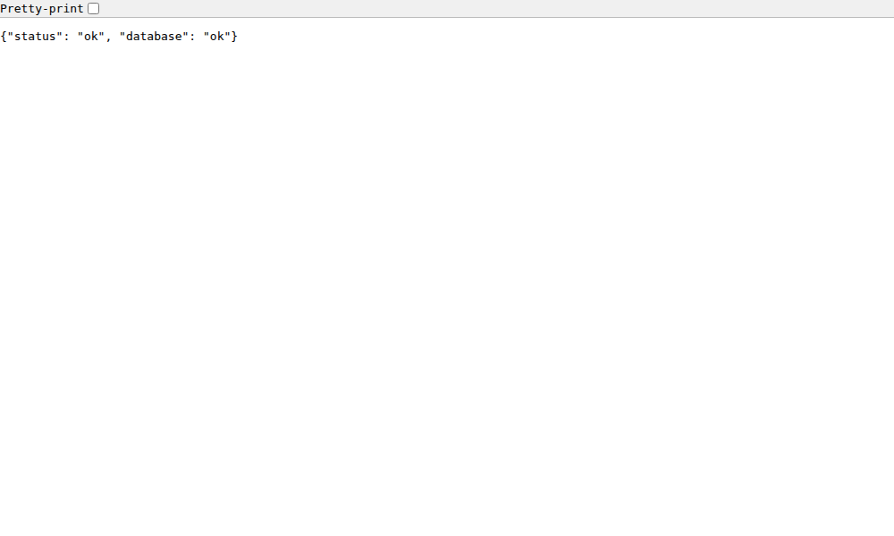

# Лаба 2.2

Nginx принимает запросы на порту 80 и передает их приложению на Python.
Приложение хранит счетчик посещений в PostgreSQL. Нужны Docker и Compose.
Команды выполняются из `lab2/compose`.

## Запуск

```bash
cp .env.example .env
```

В `.env` задать свой POSTGRES_PASSWORD. Пустой пароль не допускается.
Файл `.env` не попадает в git и в образ.

```bash
docker compose up -d --build --wait
docker compose ps
curl -i localhost/health
curl localhost/
```

`/health` возвращает HTTP 200, если приложение может обратиться к БД.
При каждом обращении к `/` счетчик visits увеличивается.
Без изменений исходников достаточно `docker compose up -d`.

Наружу опубликован только `80:80` у Nginx. У app и db нет `ports`.
Nginx и app находятся в сети frontend, app и db — в backend.
Сеть backend внутренняя. PostgreSQL хранит данные в томе pgdata.

## Проверка сохранения данных

```bash
curl localhost/
docker compose down
docker compose up -d --wait
curl localhost/
```

Счетчик продолжает расти после пересоздания контейнеров.
`docker compose down` оставляет данные; ключ `-v` удаляет том вместе с ними.
`init.sql` выполняется только при первом запуске с пустым томом.
Изменение пароля в `.env` не меняет пароль уже созданной БД.

## Сборка и push

```bash
docker login
bash build_push.sh docker.io/LOGIN/lab2-compose-app 1.0
```

LOGIN заменить своим логином. Для запуска готового образа на другой машине
указать его в `image` сервиса app и выполнить `docker compose up -d --no-build`.
Файлы Compose, nginx.conf, init.sql и заполненный локально `.env` тоже нужны.

В Dockerfile две стадии, фиксированная версия Python и non-root пользователь.
Python-зависимости устанавливаются в builder, runtime использует slim-образ.

## Проверка

`check.sh` в GitHub Actions проверяет HTTP-ответ, порты, UID приложения,
сохранение счетчика после down/up и ошибку 503 при остановленной БД.
Скриншот статуса получен из вывода команд на Ubuntu runner;
второй скриншот — ответ приложения через Nginx в браузере.



