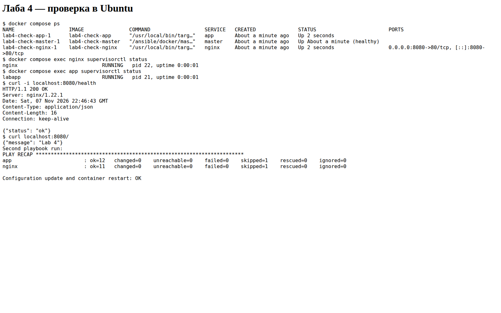
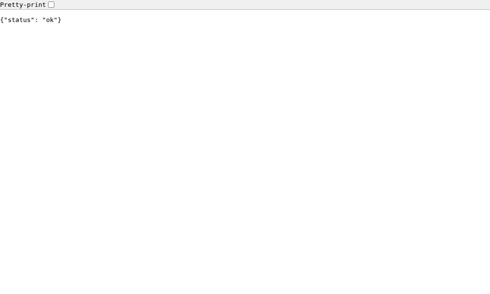

# Лаба 4

Три контейнера в одной сети: master, nginx и app. Master подключается
к серверам по SSH и запускает Ansible. В образе серверов только Debian,
SSH и Python для Ansible; Nginx и приложение устанавливает плейбук.

Нужны Docker и Docker Compose. Команды выполнять из `lab4`.

## Запуск

```bash
docker compose up -d --build
docker compose exec master ansible-playbook playbook.yml
docker compose ps
curl -i localhost:8080/health
curl localhost:8080/
```

Первый запуск требует интернета для установки пакетов.
`/health` возвращает HTTP 200 и `{"status": "ok"}`.
Снаружи доступен только Nginx на порту 8080, SSH не опубликован.
Само приложение слушает порт 8080 внутри сети.

## Роли

- `common` — проверяет Debian 12, root и память, устанавливает компоненты.
- `app` — создает пользователя, распаковывает приложение и настраивает запуск.
- `nginx` — устанавливает Nginx, проверяет конфигурацию через nginx -t
  и настраивает проксирование на app.

Исходник приложения находится в `app/app.py`, shell-скрипт запуска —
в `app/start.sh`. Архив собирается в образе master. Приложение работает
от пользователя labapp. Supervisor запускает процессы и поднимает их
после сбоя; при перезапуске контейнеров он тоже запускается.

SSH-ключ создается при старте master. Закрытая часть остается в отдельном
томе контроллера, серверы получают только открытый ключ. При первом
подключении ключи серверов принимаются автоматически внутри сети лабы.

## Обновление

Сообщение и порт задаются в `group_vars/all.yml`. После изменения исходников
или конфигурации пересобрать master и повторить деплой:

```bash
docker compose up -d --build master
docker compose exec master ansible-playbook playbook.yml
```

Можно передать сообщение без пересборки:

```bash
docker compose exec master ansible-playbook playbook.yml -e app_message=Hello
curl localhost:8080/
```

Повторный запуск без изменений должен показать `changed=0` на обоих серверах.
После пересоздания чистых контейнеров нужно снова выполнить плейбук.
Если пересоздан только сервер и SSH сообщает об изменении его ключа,
пересоздать master: `docker compose up -d --force-recreate master`.

## Проверка и остановка

```bash
docker compose exec master ansible all -m ping
docker compose exec nginx supervisorctl status
docker compose exec app supervisorctl status
docker compose restart app nginx
curl -i localhost:8080/health
docker compose down
```

После restart нужно подождать несколько секунд. `down -v` также удаляет
тома с SSH-ключами; при следующем запуске будут созданы новые.

Проверка в GitHub Actions запускает деплой на чистых контейнерах, повторный
плейбук, обновление сообщения и restart. Скриншоты результатов — в `screenshots`.

[Успешный запуск проверки](https://github.com/Vladimir119/Design-and-Development-of-Information-Systems/actions/runs/42422070252).
Первый скриншот — вывод команд с Ubuntu runner, второй — ответ приложения
в браузере через Nginx.



